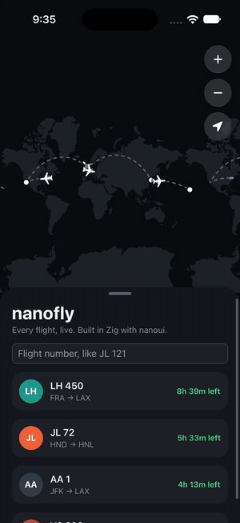

# nanofly

Flights, live, on a map: where a flight is, how high and fast, and when it
lands, by each airport's own clock. An iPhone app (and a Mac one) written in
Zig with [nanoui](https://github.com/justrach/nanoui), which draws all of it:
the map's land from Natural Earth's outlines as triangles, the great circle a
plane flies, the plane, and the card.

<p align="center"></p>

<p align="center"><a href="docs/images/nanofly.mp4">The video (MP4)</a>, recorded in the iOS Simulator with live data
(<code>--nanoui-play</code> taps; nothing is staged).</p>

The whole app is about 1.2 MB to download (its release build, zipped): 230 KB of
code, and the land, airports and airlines it carries.

Type a flight number (`JL 121`, `BA 117`, or a callsign like `KLM41F`) and
nanofly finds its route and follows it:

- **Routes** from [vradarserver's standing data](https://github.com/vradarserver/standing-data):
  each airline's routes, by callsign.
- **Where it is** from [adsb.lol](https://adsb.lol) (no key), and from the
  [OpenSky Network](https://opensky-network.org) where adsb.lol hears nothing.
  With an OpenSky API client (`OPENSKY_CLIENT_ID`, `OPENSKY_CLIENT_SECRET`),
  ten times the requests a day.
- **When it lands**: worked out from how far it has to go and how fast it is
  flying. No schedules, delays or gates: those need an airline data service.

## Build

nanofly pins nanoui by commit; `--fork=../..` builds it against the nanoui
it sits in (`apps/nanofly` of nanoui's repository). iOS builds need Xcode for
its SDK and nanoui's `tools/ios/zig-lib.sh` (Zig 0.17.0's std fixed for iOS),
here run from nanoui's checkout around it.

```sh
zig build run                     # on the Mac
zig build test
zig build $(sh ../../tools/ios/zig-lib.sh) run -Dtarget=aarch64-ios-simulator          # in the booted Simulator
zig build $(sh ../../tools/ios/zig-lib.sh) run -Dtarget=aarch64-ios-simulator --watch  # again on every save
./zig-out/bin/nanofly --flight=KLM41F --nanoui-snapshot=flight.png --nanoui-wait=8      # headless
```

`--flight=NUMBER` shows a flight without keeping it. `python3 tools/prep.py`
makes `data/` again from its sources.

## Data

See [`THIRD_PARTY_NOTICES.md`](THIRD_PARTY_NOTICES.md). The OpenSky Network
asks that live products using its API have its written permission.
