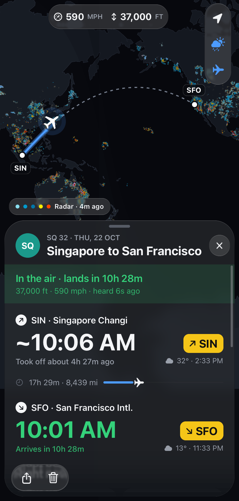
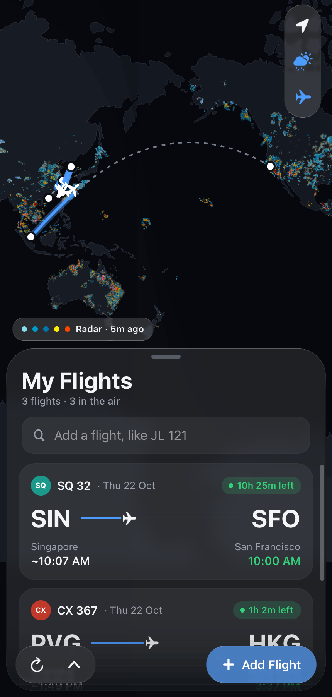

# nanofly

Flights, live, on a map, after Flighty: where a flight is, how high and fast,
and when it lands by each airport's own clock, with the weather at both ends.
An iPhone app (and a Mac one) written in Zig with
[nanoui](https://github.com/justrach/nanoui), which draws all of it: the land
from Natural Earth's outlines as triangles, the night's side of the earth, the
weather's radar, the great circle a plane flies, the planes around it, and the
card, in a sheet of Liquid Glass.

<p align="center">
  
  
</p>
<p align="center"><sub>Live data, drawn headless (<code>--nanoui-snapshot</code>).</sub></p>

Type a flight number (`JL 121`, `BA 117`, or a callsign like `KLM41F`) and
nanofly finds its route and follows it:

- **The map**: drag it (it flings), pinch it, or tap a plane to see it. The
  night's side of the earth is shaded through dusk. The glass buttons at the
  right go back onto your flights and turn the radar and the planes around on
  or off.
- **The sheet**: drag it by its head to rest at its head alone, half the
  screen or all of it. It holds your flights, or one flight's card: how it's
  doing, when it took off and lands (each by its airport's clock), the way
  flown so far, its height, speed, heading and climb, what flies it, and the
  weather at both ends.
- **The planes around**: tap one to see its callsign, type and height, and to
  follow it.

Where it all comes from (no keys needed):

- **Routes** from [vradarserver's standing data](https://github.com/vradarserver/standing-data):
  each airline's routes, by callsign.
- **Where it is** from [adsb.lol](https://adsb.lol), and from the
  [OpenSky Network](https://opensky-network.org) where adsb.lol hears nothing.
  With an OpenSky API client (`OPENSKY_CLIENT_ID`, `OPENSKY_CLIENT_SECRET`),
  ten times the requests a day. The planes around come from adsb.lol too.
- **The weather**: [RainViewer](https://www.rainviewer.com)'s radar on the map
  (its latest frame, every 10 minutes), and the weather now at each airport
  from [Open-Meteo](https://open-meteo.com).
- **When it lands**: worked out from how far it has to go and how fast it is
  flying. No schedules, delays or gates: those need an airline data service.

The whole app is about 1.2 MB to download (its release build, zipped): its
code, and the land, airports and airlines it carries.

## Build

nanofly pins nanoui by commit; `--fork=../..` builds it against the nanoui
it sits in (`apps/nanofly` of nanoui's repository). iOS builds need Xcode for
its SDK and nanoui's `tools/ios/zig-lib.sh` (Zig 0.17.0's std fixed for iOS),
here run from nanoui's checkout around it.

```sh
zig build run                     # on the Mac
zig build test
zig build $(sh ../../tools/ios/zig-lib.sh) run -Dtarget=aarch64-ios-simulator          # in the booted Simulator
zig build $(sh ../../tools/ios/zig-lib.sh) run -Dtarget=aarch64-ios-simulator --watch  # again on every save
./zig-out/bin/nanofly --flight=SQ32 --nanoui-snapshot=flight.png --nanoui-wait=30       # headless
```

`--flight=NUMBER` shows a flight without keeping it; more than one are listed. `python3 tools/prep.py`
makes `data/` again from its sources.

## Data

See [`THIRD_PARTY_NOTICES.md`](THIRD_PARTY_NOTICES.md). The OpenSky Network
asks that live products using its API have its written permission, and
RainViewer's free radar is for personal and educational use.
